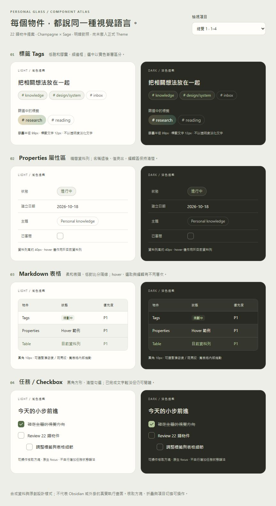
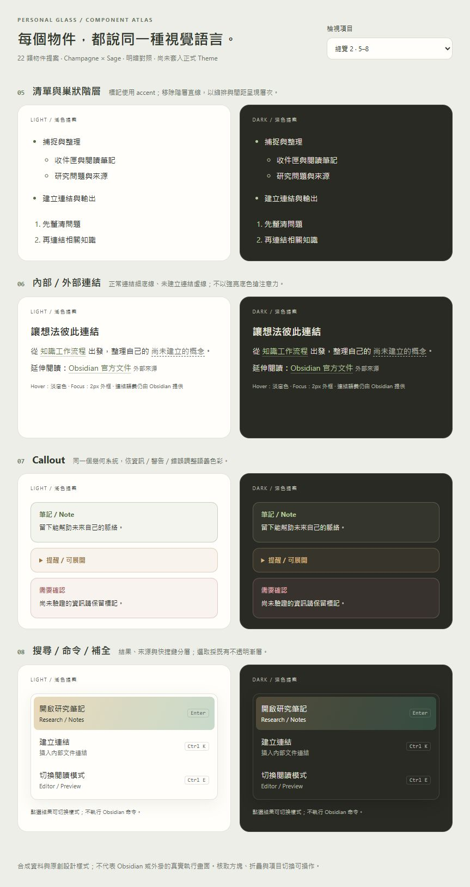
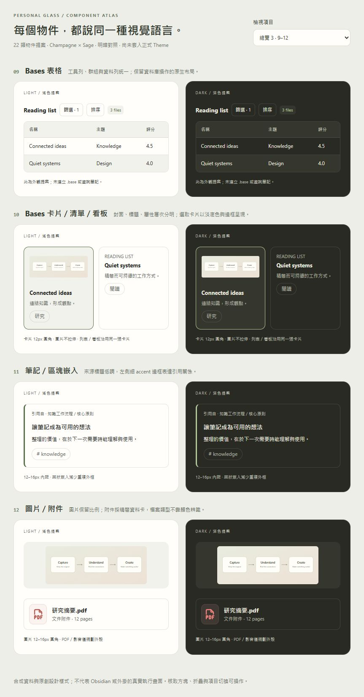
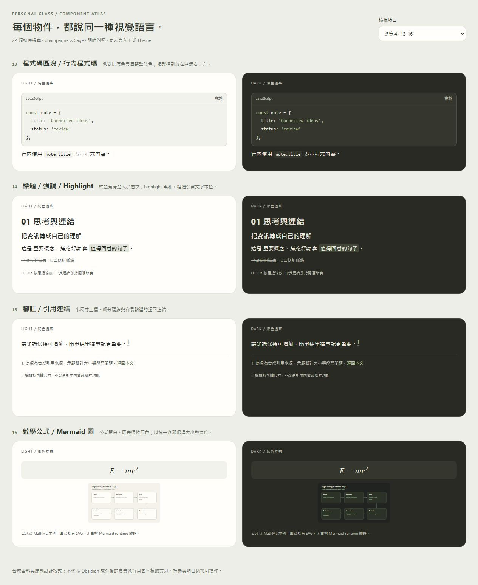
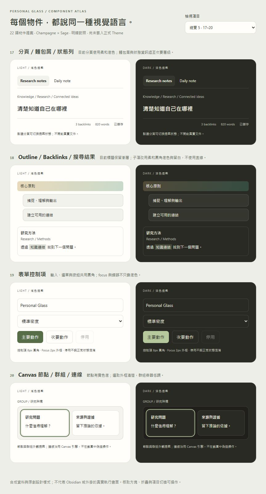
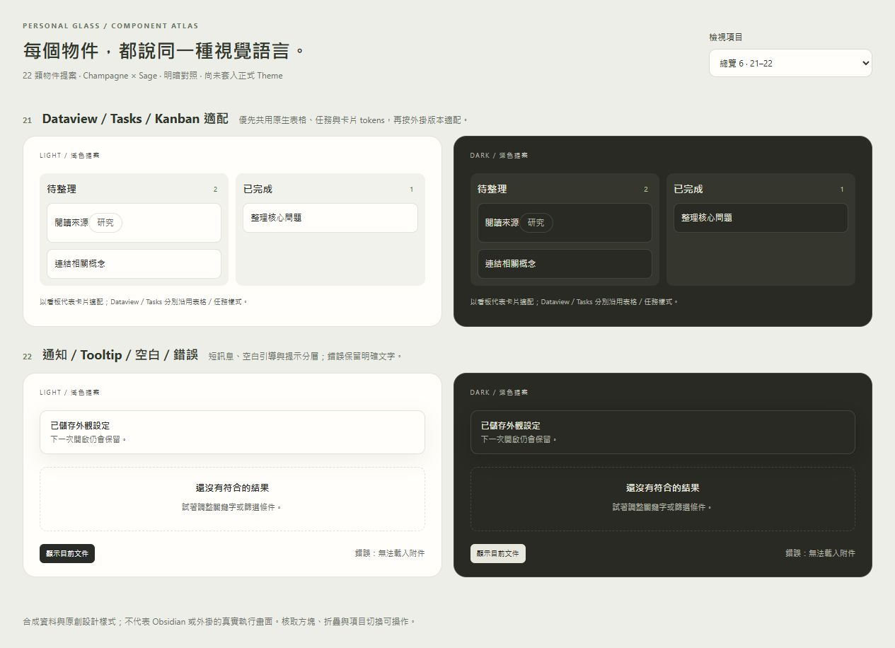
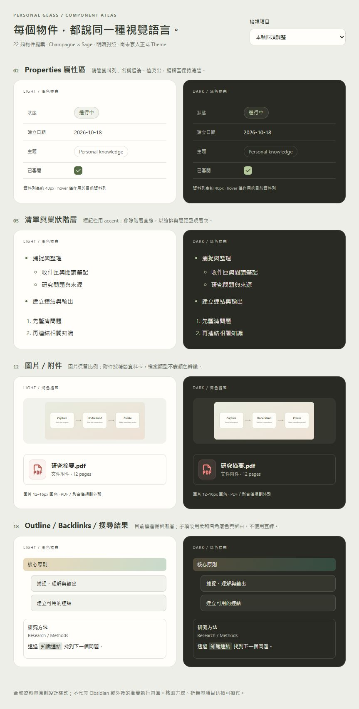

# Personal Glass · 22 類物件視覺提案

狀態：使用者已核准設計並要求實作；Theme 0.5.0 的 CSS 覆蓋與待驗證項目見 [元件實作](../COMPONENTS.zh-TW.md)。以下保留 review 當時的提案與截圖。這份文件是 Theme 元件的設計提案，不是個人知識計畫。所有資料均為合成，未使用 Vault 筆記。

互動圖鑑：啟動 `npm run preview` 後開啟 `/objects`。目前 review server 為 `http://127.0.0.1:4186/objects`。右上選單可切換單項或六組總覽；每個範例都有明暗對照。

## 共用樣式規劃

- 沿用 Champagne × Sage、目前 Theme 明暗文字色與字體，不重設品牌配色。
- 內容物件使用實色或與 panel 混合的柔和色彩；不對文字套透明度、模糊或濾鏡。
- 圓角層次：控制項 6–8px、表格／程式碼 10px、卡片／Callout 12–14px；99px 膠囊保留給 Tags。
- 1px 低對比邊框、2px 鍵盤 focus；hover、目前選項、已完成、disabled 不混用。
- 文件／命令選取沿用不透明雙色漸層；資料表與卡片使用較安靜的選取底色，避免整頁過度醒目。
- 陰影以浮層為主；內容卡片以邊框和留白區分。輕微透明只留給應用背景／面板。
- 正式實作優先使用 Obsidian CSS variables，Reading／Live Preview 保持同一個視覺方向，不改寫輸入或插件行為。

## 每項規劃與範例

P1 是第一批文件核心；P2 是資料／導覽；P3 為版本適配與進階內容。

| 編號 | 物件／優先度 | 預計實作樣式 | 必要狀態或驗收 | 單張明暗圖 |
| --- | --- | --- | --- | --- |
| 01 | Tags · P1 | 12px 膠囊、低飽和底色、1px 細邊框；階層名稱保留原文 | inline／Properties／sidebar，hover／focus／篩選中；不覆蓋外掛自訂色 | [圖](objects/01-tags.jpg) |
| 02 | Properties · P1 | 約 40px 資料列、次要名稱／主要值、輕量分隔；清單值沿用膠囊 | text／list／date／number／checkbox、編輯／空值／focus；長值換行 | [圖](objects/02-properties.jpg) |
| 03 | Markdown 表格 · P1 | 10px 外框、柔和表頭、淡分隔、列 hover；斑馬紋與密度可選 | Reading／Live Preview、儲存格選取／編輯、寬表格捲動與列印換行 | [圖](objects/03-tables.jpg) |
| 04 | 任務／Checkbox · P1 | Accent 勾選、約 16px 控制項；完成文字輕淡加刪除線 | unchecked／checked／focus、巢狀；非標準任務語法只由外掛處理 | [圖](objects/04-tasks.jpg) |
| 05 | 清單 · P1 | Accent 標記、穩定縮排與項目間距、不使用階層直線 | 無序／有序／巢狀／折疊；不破壞 CodeMirror 行幾何 | [圖](objects/05-lists.jpg) |
| 06 | 連結 · P1 | 正常細底線、未建立筆記虛線、hover 淡底、focus 清楚 | 內部／外部／未建立、行內嵌套／長網址 | [圖](objects/06-links.jpg) |
| 07 | Callout · P1 | 12–14px 圓角；資訊 Sage、提醒暖金、錯誤暖紅；標題與正文分層 | 預設／折疊／巢狀／長標題、語義色與灰階辨識 | [圖](objects/07-callouts.jpg) |
| 08 | 搜尋／命令／補全 · P1 | 12px 浮層、8px 結果列；路徑小字、右側快捷鍵、漸層選取 | 滑鼠／鍵盤選取、匹配字／空結果；不新增 slash menu 行為 | [圖](objects/08-suggestions.jpg) |
| 09 | Bases 表格 · P2 | 工具列按鈕、計數 badge、淡表頭／群組、儲存格 focus | 排序／篩選／群組／編輯／空白、版本化 DOM 適配 | [圖](objects/09-bases-table.jpg) |
| 10 | Bases 卡片／清單／看板 · P2 | 共用 12px 卡片、封面比例、標題／摘要／屬性；選取細邊框與淡底 | 有／無封面、長標題／屬性、群組；圖以卡片代表，列表／看板需後續實機展示 | [圖](objects/10-bases-cards.jpg) |
| 11 | 筆記／區塊嵌入 · P2 | 來源次要文字、左側 3px accent、12–16px 留白、細外框 | 完整筆記／區塊／巢狀／來源缺失；不重複堆疊厚框 | [圖](objects/11-embeds.jpg) |
| 12 | 圖片／附件 · P2 | 比例不變的 12–16px 圖片圓角；PDF／影音外殼採資料卡 | 尺寸／載入錯誤／嵌入、PDF／音訊／影片；不能保證 iframe 內部樣式 | [圖](objects/12-attachments.jpg) |
| 13 | 程式碼 · P2 | 10px 區塊、淡底；語言／複製列；行內 4px 圓角 | 語法色彩對比、長行／橫向捲動、Reading／編輯；複製由原生功能提供 | [圖](objects/13-code.jpg) |
| 14 | 標題／強調／Highlight · P2 | H1–H6 分層、中英混排、原文字色粗體／斜體、柔和 highlight | 長標題／折疊／內聯格式；圖呈現代表性層級，六級需正式 fixture 補齊 | [圖](objects/14-typography.jpg) |
| 15 | 腳註 · P2 | 小上標、細分隔、次要文字與易點選返回連結 | 多段／多行／返回 focus、列印連續性 | [圖](objects/15-footnotes.jpg) |
| 16 | 公式／Mermaid · P2 | 公式留白與淡容器、圖表保留語義色、窄版內部溢位 | inline／display math、明暗圖、長圖；此圖為 MathML＋既有原創 SVG，非 Mermaid runtime | [圖](objects/16-math-diagrams.jpg) |
| 17 | 分頁／麵包屑／狀態列 · P2 | 8–10px 分頁、淡選取底、路徑與狀態次要色 | active／inactive／失焦／長檔名、關閉按鈕與 stacked tabs | [圖](objects/17-tabs.jpg) |
| 18 | Outline／Backlinks／搜尋結果 · P2 | 目前標題漸層、縮排的柔和圓角子項、來源與匹配片段分層 | 深層標題／目前項／折疊／長結果／焦點 | [圖](objects/18-sidebars.jpg) |
| 19 | 表單控制項 · P2 | 8px input／select／button；accent 主要動作；focus 明確 | hover／focus／disabled／invalid、錯誤文字／slider／toggle；圖呈現主要類型 | [圖](objects/19-controls.jpg) |
| 20 | Canvas · P3 | 實色節點、12px 群組外殼、accent 選取外框、低調群組標題 | selection／focus／縮放／不同節點類型；連線保留引擎且需實機驗證 | [圖](objects/20-canvas.jpg) |
| 21 | Dataview／Tasks／Kanban · P3 | 表格／任務沿用 03／04；看板欄淡底、卡片 8–12px、標籤沿用 01 | 固定外掛版本、不同資料量／空白／自訂色；圖以看板作代表 | [圖](objects/21-plugins.jpg) |
| 22 | 通知／Tooltip／空白／錯誤 · P3 | 10px 通知、6px Tooltip、空白狀態淡虛線；錯誤需文字與語義色 | success／error／長文／鍵盤、觸控與 reduced motion；圖含代表性靜態狀態 | [圖](objects/22-feedback.jpg) |

## 六組總覽

## Review 與落地

可依編號回饋：保留／調整底色／減少邊框／增加密度／加大圓角。每一類先確認方向，再補正式 CSS 與原生 Obsidian fixture 的所有狀態；本圖鑑不是各個子類型與狀態已全數實作的宣告。

本輪只新增 `preview/objects.*`、預覽路由與這份圖鑑。`src/styles`、Theme 版本及正式 release 未變；未部署 Vault 或啟用插件。提案 CSS 有獨立 `.specimen` 外殼，完全排除於 Theme build。

驗證：六組明暗總覽已在實際瀏覽器逐組檢視；22 張單項圖片與 6 張總覽已匯出。核取方塊、Callout 折疊、命令選單選取、分頁狀態與檢視選單可操作；頁面只含合成資料，第三方操作按鈕是外觀示例。正式對比、全狀態、版本相容與 Obsidian runtime 驗證仍屬後續實作。

## Review 修訂 · 四則標註

1. Properties／任務勾選框統一為 20px 方框、6px 圓角；勾選用 accent 實色與 Tabler 勾號，保留原生 checkbox 語義、Space 操作及獨立 focus。強制色彩模式回退原生 appearance。
2. 巢狀清單移除垂直階層線，只保留縮排與標記。
3. PDF 使用 MIT 授權 Tabler `file-type-pdf` 圖示，以暖紅色文件輪廓搭配柔和底色；檔名與類型文字仍保留。
4. Outline 子項改成有縮排、7px 間距、9px 圓角的淡底資料列；hover 增強底色與邊框，鍵盤 focus 沿用獨立輪廓，不使用左側直線。

互動圖鑑右上可選「本輪四項調整」。此輪仍僅修改 review fixture，未套用正式 Theme。圖示來源與改色衍生說明見 `preview/assets/README.md`。

